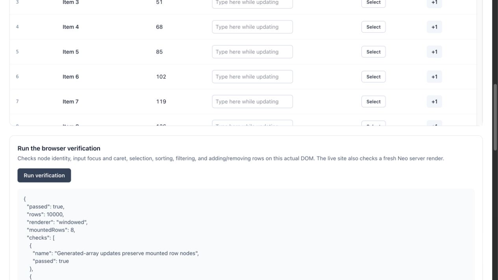

# Windowed lists, OIDC and runtime verification

The default stress view now retains all 10,000 models and mounts only a small fixed-height DOM window. Native SSR delivers 32 rows and inert data for every record. The shared renderer lives in `client/windowed.js`; the escaped data writer lives in Neo `std:http_data`. Focused rows stay mounted through scrolling and reorders; offscreen drafts and selection belong to models. An explicit `render=full` diagnostic remains expensive. Native SSR offers a no-JavaScript full-render link; static export needs JavaScript for records beyond its initial window.

## Actual browser results

The native page passes 13 checks at 10,000 records; static export passes 12 (no server refresh). Checks cover mounted-node identity, focus/draft/caret, selection, reorder, filter, add/remove, the final logical row, a pinned offscreen editor, bounded row count, fresh native data, empty filters and an intentional redraw negative control. A separate unit test checks viewport growth and disposal. The final native verification records p95 full model+DOM update **2.1 ms**, steady DOM patch **1.6 ms**, and worst observed frame **14.7 ms** during that short run. Raw [native results](final-10000.json) and [export results](export-10000.json) retain every check.

A longer windowed sample completed **796 live ticks** with **0 frames over 50 ms**, p95 complete update **5.1 ms** and p95 DOM patch **3.5 ms**. It mounted 15 rows while retaining 10,000 records. The saved full-DOM reference had 10,000 mounted rows, p95 DOM patch **20 ms**, 381 frames over 50 ms and a worst frame of **2.58 seconds** across 252 live ticks. See [windowed sustained data](windowed-10000.json) and [saved full-DOM data](baseline-10000.json). Runs differ in duration and browser lifecycle activity; the baseline also encountered accessibility-tree serialization overhead. These are development diagnostics on a busy host, not a controlled paint benchmark or a guarantee of zero long frames. Another windowed check during other work recorded a 75 ms frame, so no universal sub-frame claim is made.

Windowing changes how much DOM is materialized. These measurements do not claim an equally fast update of 10,000 simultaneous row nodes. Browser find, printing, screen-reader coverage and variable-height rows need separate consideration. [The API notes](../../../docs/windowed-lists.md) state those limits.

## Native authentication and database

Neo provides a reusable duplicate-member JSON check and existing native RSA/SHA-256. `axon-libs/jwt` implements bounded compact RS256/JWKS verification and the OIDC code-flow ID-token profile. `axon-libs/oauth2` uses it before accepting an exact issuer/client/nonce/time policy and a matching authenticated userinfo subject; NeoKit enables it through fixed issuer/JWKS configuration. Independent OpenSSL-signed tests include valid audience forms, signatures, encoding, algorithm confusion, duplicate escaped keys, ambiguous/invalid keys, issuer, audience, nonce, expiry, issued time, optional not-before/access-token hash, state tampering and mismatched userinfo. Five test groups pass. Monolithic and prepared-library dashboard builds pass real password, CSRF, authorization, concurrent durable mutation and restart checks. No real provider account was used; discovery, refresh-token lifecycle and persistent key caching remain gaps.

The native PostgreSQL client passes against the official PostgreSQL **17.11** server with SCRAM-SHA-256, from macOS arm64 and Linux aarch64. The fixture checks parameterized CRUD, injection-shaped Unicode, SQL NULL, exact int64, a 100 KB result, SQL-error recovery and rejection of an open transaction from the idle pool. It uses a disposable loopback database. TLS, database production deployments and ORM parity are separate work.

## Linux execution

The dashboard integration passes in **ARM64 Linux scratch** and **x86-64 Linux scratch under emulation**, using a nonroot UID, read-only root, dropped capabilities and Docker init. It exercises 600,000-round password verification, CSRF, user separation, two workers with 24 concurrent writes, and restart persistence. Both ELF binaries have no interpreter, dynamic dependencies or undefined symbols. Neo now chooses lld for same-architecture Darwin-to-Linux builds. Compose enables init so Linux PID 1 forwards termination correctly. This does not add native request draining.

[Image/binary identities and PostgreSQL details](linux-postgres.json) preserve the execution record. The complete Ubuntu/Bun production Dockerfile, real OAuth services, public deployment, native graceful request draining, asynchronous rendering/RSC, distributed cache and full ORM/cloud adapters remain unverified or unimplemented as documented. The existing local VM was stopped again and Docker's prior default context restored; disposable test images/data were removed.

## Performance

[The final production matrix](../../parity-results/2026-11-07-windowed-oidc/REPORT.md) compares matched uncached catalog/authenticated/database workloads with the installed Next 16.1.1 production fixture. Builds and container validation finish before this matrix. An earlier matrix overlapping regression builds and VM startup is retained under the `-exploratory` directory and is not used for final comparisons. [List delivery measurements](SSR.md) separately compare equal logical data with different DOM/payload strategies. [Binary identities](binaries.json) and raw samples make both comparisons reviewable.

The 24 list-delivery trials all pass. At 10,000 records and 32 connections, the
response changes from **9,462,696 to 78,675 bytes** and median throughput from
**153.3 to 3,403.8 req/s (22.2×)**. The bounded HTML plus full inert-data payload
is about 120× smaller. These gains explicitly include that product-level
payload change; they do not compare identical HTML.

The 78 matched production trials all pass. At 32 connections the monolithic
build delivers **7,209.5 authenticated task pages/sec versus Next 131.7 (54.8×)**,
and **83.4 fully flushed mutations/sec versus 69.4 (1.2×)**. Small and interactive
catalog throughput are within 2% of the saved pre-expansion NeoKit baseline;
the larger catalog result is 16% higher, subject to uncontrolled host noise.
The normal prepared-library path is checked separately in the
[updated profile supplement](../../parity-results/2026-11-07-windowed-oidc/CACHE-PROFILE.md).

The updated prepared-library authenticated profile delivers **6,245.6 req/s**
versus **7,232.6 req/s** monolithic in its own three-round check (about 14%
slower). Both pass the same semantic and application integrations. The main
Next comparison uses the explicitly documented monolithic profile; prepared
throughput should not be silently reported as that profile. The final Bun suite
passes 21 tests and 36,032 assertions; the full framework suite also passes its
20 Python tests and native/HTTP/export/consumer/scaffold/feature/dashboard checks.
