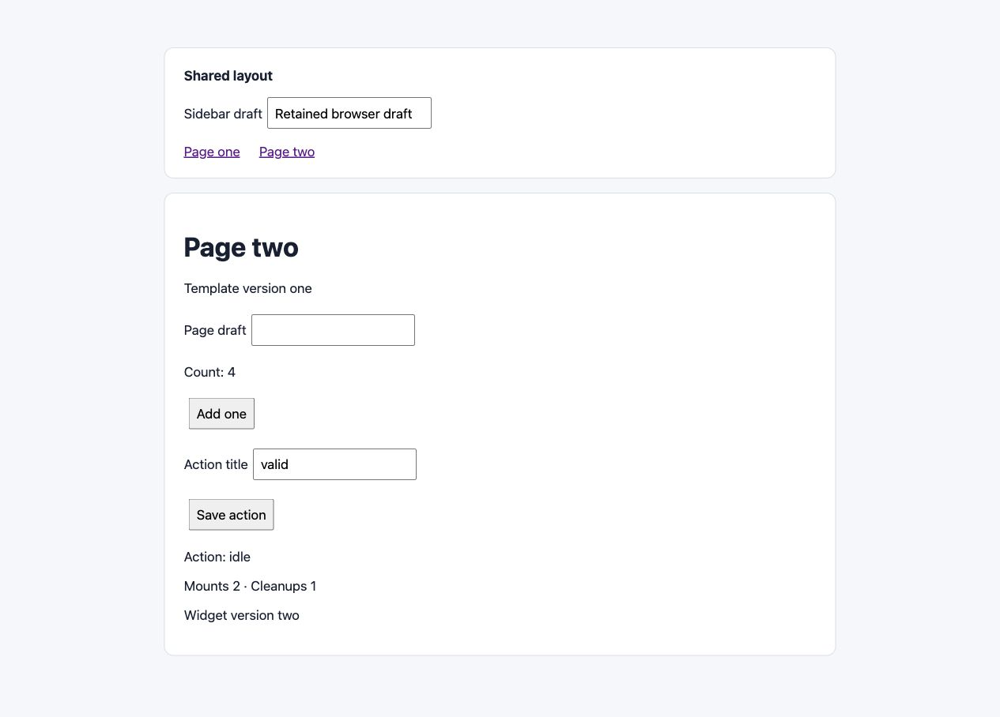

# Actual-browser verification

Tested after the host was unlocked, using the in-app Chromium browser against
native local servers and a separate ordinary static-file host. All accounts,
credentials, documents and tasks were disposable test fixtures.

| Flow | Observed result |
|---|---|
| Nested navigation and history | Sidebar draft survives navigation/back; counter stays at 4; mount/cleanup counts advance correctly |
| Metadata | Description changes from page one to page two |
| Typed action | Optimistic count changes while pending, then rolls back on the real 422 validation response |
| Dashboard | Password login, enhanced create/toggle/delete forms, reload persistence and logout pass |
| Escaping | `<script> café & browser` displays as task text; no injected inline script appears |
| Hot client update | Widget version changes without resetting count or sidebar draft; old widget cleanup runs |
| Compile failure and recovery | Visible unknown-prop overlay; existing app/state remains usable; repairing the template removes the error and refreshes HTML while restoring the draft |
| Streaming | Both the streamed shell and delayed content render as HTML; independent socket tests verify early flush timing |
| Static export | Counter increments to 2 and guide filtering works from static files; the about page contains zero script tags |
| Console | No application warnings/errors observed in the checked flows |

## Real DOM list checks

Both 1,000 and 10,000 rows pass all nine checks: row-node identity across 24
generated-array updates; focus, caret and draft retention; reorder/selection;
filtering; add/remove; a fresh native render; correct IDs; no unexplained blank
frames; and a negative control that detects full redraw/focus loss.

| Rows | p95 steady keyed DOM patch | Keyed focus losses | Unexplained blank frames | Observed limitation |
|---|---:|---:|---:|---|
| 1,000 | 4.2 ms | 0 | 0 | Structural/full-redraw operations produce long frames |
| 10,000 | 51.1 ms | 0 | 0 | Large structural operations and full redraw stall for seconds |

The 10,000-row metrics accumulate after expanding the same initially 1,000-row
page. Its recorded worst frame reaches about 5.9 seconds. This is deliberately
unvirtualized DOM, not a claim of smooth 10,000-row rendering. These instrumented
checks include browser-control overhead and concurrent host activity; they are
not a clean browser performance comparison with Next.js. DOM patch times omit
subsequent layout and paint. Raw [1,000-row](stress-1000.json) and
[10,000-row](stress-10000.json) results preserve these limits.

Reproduce the local fixture with `NEOKIT_LIBRARY_CACHE=off python3 -m
tests.browser_fixture`, then use the URLs in `build/browser-check/control.json`.
The source fixture is separate from the application examples; template/client
edits made during verification stay under the ignored build directory.

## Native issue found during the verification pass

Repeated dashboard HTTP checks exposed intermittent dropped connections in the
previous macOS kqueue path. The revised runtime removes cross-worker descriptor
forwarding: workers watch the shared listener, accept bounded local batches and
own their connections until close. Linux backends are unchanged.

An independent binary-echo peer reproduces the dropped connection with the old
kqueue source, then passes 4,096 short-lived concurrent connections each with
two and four workers on the revised backend. Sixty complete dashboard runs
(1,440 concurrent durable mutations, plus authentication and restart checks)
also pass. Requests are never retried to hide a failure. The
[regression record](ownership-regression.json) stores the comparison and binary
identities; `axon/tests/http_handoff.py` is part of the language integration suite.
