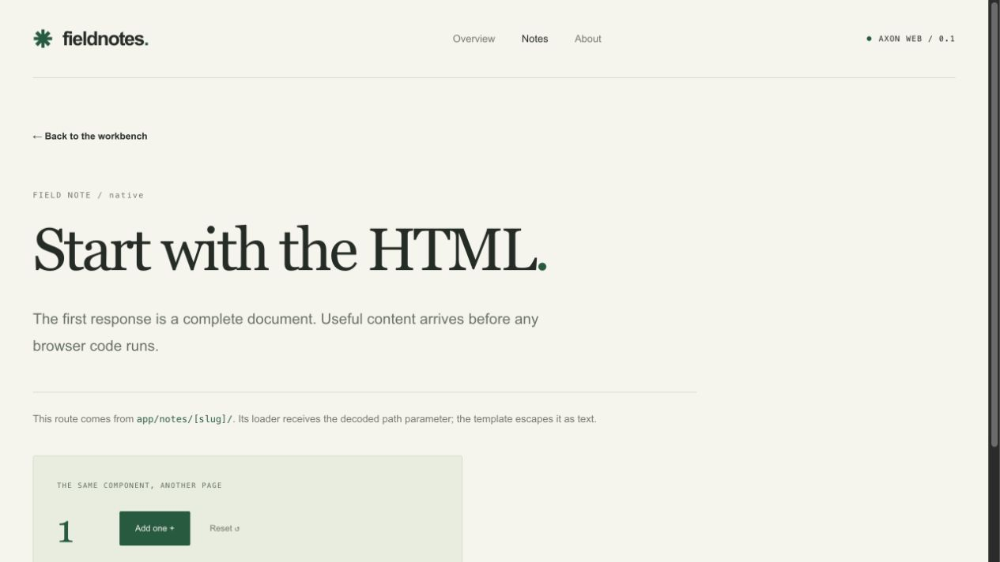

# Axon / Astro build-speed comparison

Native Linux aarch64, 5 shuffled cold/warm build rounds. Production uses LLVM -O3. Both frameworks have their build tools/dependencies available. Axon compiler libraries are explicitly prepared once; no application cache is retained for cold project builds.

| Build | Clean project seconds | Warm rebuild seconds |
|---|---:|---:|
| Axon-SSR | 0.647 | 0.284 |
| Astro-SSR | 0.815 | 0.735 |
| Axon-static | 0.637 | 0.286 |
| Astro-static | 0.738 | 0.695 |
| Axon-dev | 0.531 | 0.296 |

A genuinely first-use Axon production build, with BOTH project and compiler-library caches empty: **2.762s** median (2.718–2.974s). Framework-only preparation via `./web prepare`: **2.428s** once. These costs are not hidden in the clean-project table. Astro dependency installation is also outside the table.

Cold removes project outputs/native cache, Astro output and its `.astro` cache. Installed toolchain libraries and OS caches remain. Every cold Axon project trial asserts a native application compile miss plus a separately checked dependency-artifact hit. The artifact source list contains runtime/stdlib/framework code; checks reject catalog data in cached IR/object files. Applications are always rechecked and compiled; changing dependency sources/compiler/flags invalidates their artifact. Dev uses -O0 for application code and the prepared -O3 libraries. Both retain source/type/refinement/ownership/effect checks and embedded runtime checks. Linux output remains a single static ELF.

| SSR (32 connections) | Framework | Median req/s (min–max) | CPU µs/request | Sampled peak PSS MiB |
|---|---|---:|---:|---:|
| small-ssr | Axon | 74,156 (62,506–75,612) | 13.44 | 13.98 |
| small-ssr | Astro | 4,203 (4,066–4,449) | 238.19 | 283.88 |
| small-ssr | Axon-before | 79,512 (72,619–91,187) | 12.58 | 14.99 |
| large-ssr | Axon | 2,774 (2,395–2,803) | 360.45 | 4.91 |
| large-ssr | Astro | 289 (106–375) | 3478.76 | 258.09 |
| large-ssr | Axon-before | 3,012 (2,996–3,083) | 334.18 | 5.12 |
| interactive-ssr | Axon | 29,954 (29,817–30,028) | 33.29 | 6.40 |
| interactive-ssr | Astro | 2,679 (2,657–2,804) | 372.86 | 278.33 |
| interactive-ssr | Axon-before | 34,644 (32,788–38,399) | 28.95 | 7.44 |

27 runtime trials; 3 interleaved rounds per cell, 1s warmup + 3s load, one server CPU and separate load CPU, closed-loop HTTP/1.1 with identity encoding. The independent HTML oracle checks every catalog cell, escaping, fresh timestamps and changed query inputs. Zero accepted socket/status/timeout errors. Short local samples are subject to host noise; this is a catalog regression test, not framework feature parity or production capacity. The pre-change native binary is identified separately when supplied. No physical energy claims.

See raw JSONL, build/HTTP logs, versions/source hashes, preparation artifacts and static-ELF audits alongside this report. Reproduce with `bench/astro_build_speed.py` in the framework benchmark tools container; frozen JavaScript dependencies must be installed first.

The host is an Apple M1 Pro with 16 GiB RAM, Docker Desktop native ARM64, a four-CPU/4 GiB benchmark container and no container swap. Host swap was in use; ranges and short-sample limitations apply. See `host.json` for the actual image and host metadata.

The static dependency boundary trades some whole-program optimization for build speed. Relative to the pre-change native binary, these samples show about **7–14% lower SSR throughput**, with lower sampled PSS. Current Axon still outperforms Astro here. `AXON_LIBRARY_CACHE=off ./web build` selects monolithic compilation; it has a longer clean build and remains available for performance-sensitive projects. This report does not claim that path's exact current throughput.

[Reproduction guide](../../BUILD-SPEED.md). [Additional verification](verification.json) includes cache/ABI/effect/corruption checks, native overflow checks, 103 compiler unit tests, independent evaluator/parser checks, HTTP concurrency, separate-consumer builds, empty-root Linux execution and browser SSR/static interactions. The initial profile shows why the earlier two-executable pipeline was slow. The first full reproduction was 16.77s: renderer 5.86s plus server 10.52s, with 6.24s of LLVM time in the server compilation.

