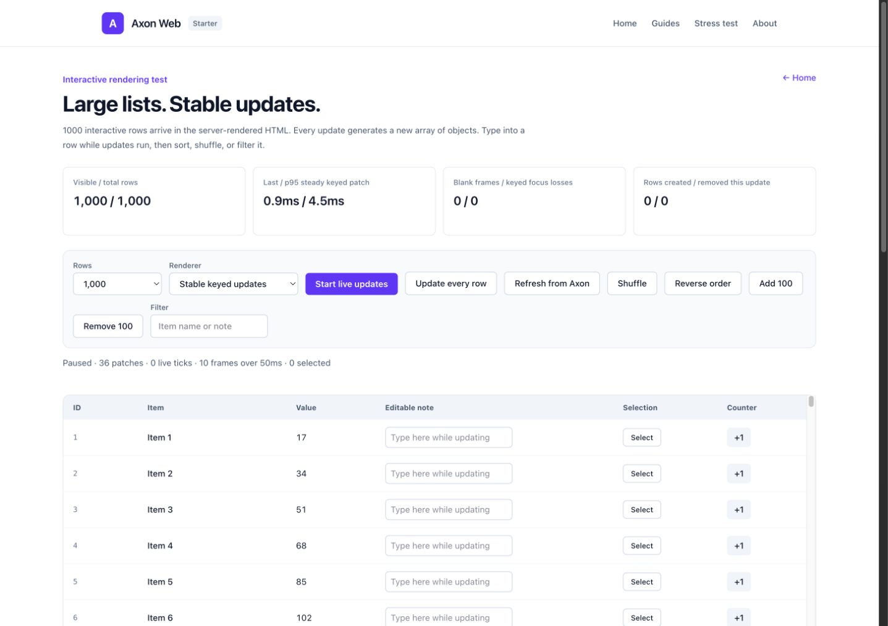

# Interactive list rendering test

Live page: http://127.0.0.1:8094/stress
Static export: http://127.0.0.1:8095/stress/

The default page contains 1,000 actual server-rendered interactive rows, with no
virtualization. A lazy browser module adopts the existing DOM by stable row ID.
Every update regenerates the array and all objects; cached fields and a same-order
fast path avoid touching unchanged controls. Live ticks change 10% of values with
a 100ms timer scheduled after each patch. Manual updates change all values. Filtering,
reordering, adding/removing and fresh Axon HTML refreshes are supported.

Final real-browser verification: **9/9 checks passed at 1,000 rows** on the live SSR
page, **8/8** on the static export. Checks cover DOM identity, input focus/caret/draft,
selection, filtering, reordering, additions/removals, fresh server rendering (SSR
only), displayed row IDs and sampled empty frames. The deliberate full-redraw
negative control replaced every node and lost focus, as expected. Keyed updates
recorded **0 focus losses and 0 sampled blank frames**. This is not proof against
every possible visual artifact or every browser/device. Browser was in-app Chrome 156.

The final live check recorded a 4.5ms p95 steady DOM patch, and 84ms p95 across all
operations including structural updates and the deliberate redraw. These short,
instrumented observations exclude subsequent layout/paint; they are not a formal
benchmark or an FPS guarantee. A separate sustained typing run retained the draft
and focused field across 199 live ticks, with no row creation/removal, blank frames
or list layout shifts; its observed steady p95 was 14.6ms.

**Heavy case:** an earlier 10,000-row run passed the original 8 state/identity/focus
checks, but had severe stalls: a 22.6s worst observed frame gap and approximately
2.8s p95 steady patch time in that instrumented session. It preceded the final
cloned-row ID display correction and additional ID-cell check. Its raw observations
are retained as preliminary evidence, not claimed as a final smoothness result.
The optional 5,000/10,000-row modes are labeled heavy. Virtualization, reduced live
DOM and scheduling work remain necessary for comfortable operation at that scale.

Bun passed 8 client tests, including 500 seeded structural transitions against an
independent array/DOM model and both state-preserving move and older-browser focus
restoration paths. The full framework suite passed 13 template/CSS tests, native
HTTP framing/escaping/assets/48 concurrent requests with 1 and 2 workers, 6-page
static export and an isolated consumer. This adds browser-only JavaScript; the Axon
native runtime gains no dependency. Existing page navigation/form-fragment whole-
subtree replacement semantics are unchanged; the list deliberately uses keyed patching.

Use **Start live updates**, type a note, then try **Reverse order**, filtering,
**Refresh from Axon**, and **Run verification**. Choose **Full redraw (comparison)**
to reproduce replacement/focus loss. The self-test pauses automatic updates and
restores the original data afterward.

