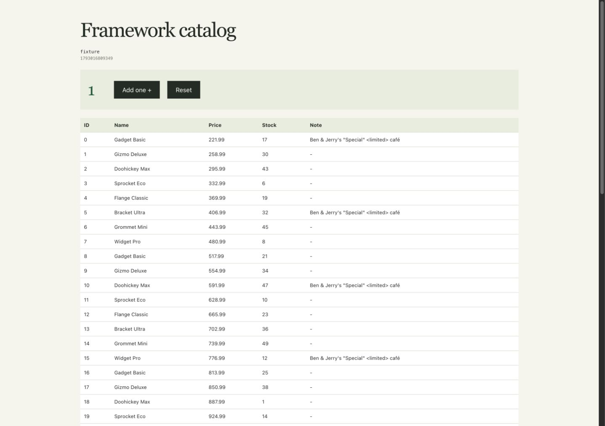

# Tailwind: Axon Web vs Astro vs Next.js

Recorded 2026-10-26T12:03:06.250423+00:00. Apple M1 Pro; native Linux ARM64 Docker, 4 CPUs / 4 GiB with container swap disabled. Node v24.22.1, Bun 1.3.13. Tailwind 4.3.3; Astro 7.4.2; Next.js 16.4.3; React 19.3.1. Host swap/scheduling may affect short samples.

The same 3-row, 1,000-row and interactive 50-row catalog, same generated data/escaping/checksum and same Tailwind design. Axon uses its native CLI integration; Astro uses the official Tailwind Vite plugin; Next App Router uses Tailwind PostCSS and React useState. Default framework SSR/streaming and hydration are retained. Browser probes use request-time SSR. Static output is built and checked separately.

## Production builds

| Framework | Clean SSR s | Warm SSR s | Clean static s | Warm static s |
|---|---:|---:|---:|---:|
| Axon | 0.868 | 0.417 | 0.786 | 0.401 |
| Astro | 1.091 | 1.008 | 0.815 | 0.764 |
| Next | 5.282 | 1.792 | 4.085 | 1.541 |

36 timed builds (3 shuffled cold/warm rounds). Dependency installs and checked framework-library preparation are outside timing, for all frameworks. Cold deletes project outputs and application caches; prepared Axon dependencies and installed JS packages remain. Axon preparation took 2.867s separately, including Docker exec overhead; application code is always checked and compiled. This is not a fully empty toolchain/install comparison.

## Complete page payload

| Route | Framework | HTML KiB | HTML gzip KiB¹ | External CSS KiB | Inline JS KiB² |
|---|---|---:|---:|---:|---:|
| small-ssr | Axon | 1.14 | 0.65 | 6.37 | 0.00 |
| small-ssr | Astro | 1.13 | 0.64 | 6.33 | 0.00 |
| small-ssr | Next | 7.81 | 2.42 | 6.34 | 5.94 |
| large-ssr | Axon | 102.70 | 9.70 | 6.37 | 0.00 |
| large-ssr | Astro | 102.50 | 9.70 | 6.33 | 0.00 |
| large-ssr | Next | 399.71 | 31.61 | 6.34 | 296.28 |
| interactive-ssr | Axon | 6.10 | 1.47 | 6.37 | 0.00 |
| interactive-ssr | Astro | 6.45 | 1.60 | 6.33 | 0.39 |
| interactive-ssr | Next | 26.57 | 4.45 | 6.34 | 19.79 |

¹ Offline gzip estimate, not a claim the server compresses HTML. ² Inline JS is already part of HTML and is not added twice. Next includes the default RSC payload. External JS resource totals below come from the real browser, including transitive/dynamically discovered chunks; the old direct-HTML-resource counts are deliberately not used for total page size. Inline CSS, when used by a framework, is already part of HTML.

## Browser cold navigation

Measured in the visible in-app browser on the host, against the Linux production servers through local Docker port forwarding. Each trial uses a new origin/port, preventing resource-cache reuse. No throttling, external fonts, CDN or WAN latency. Three rounds per route/framework; browser viewport/user agent, per-resource encoded/decoded bytes and timings are retained. The browser window changed between 1280×720 (5 trials) and 1452×1024 (22 trials); paint/load timings are exploratory and do not establish a controlled browser speed ranking. These local numbers are not internet/mobile predictions or Lighthouse/field scores.

| Route | Framework | External + inline JS decoded KiB | Total page decoded KiB³ | Actual encoded body KiB³ | Requests⁴ |
|---|---|---:|---:|---:|---:|
| small-ssr | Axon | 0.00 | 7.51 | 7.56 | 2 |
| small-ssr | Astro | 0.00 | 7.47 | 7.52 | 2 |
| small-ssr | Next | 451.82 | 460.04 | 137.38 | 8 |
| large-ssr | Axon | 0.00 | 109.07 | 109.12 | 2 |
| large-ssr | Astro | 0.00 | 108.83 | 108.88 | 2 |
| large-ssr | Next | 742.16 | 851.94 | 167.96 | 8 |
| interactive-ssr | Axon | 5.44 | 17.92 | 17.97 | 5 |
| interactive-ssr | Astro | 0.39 | 12.78 | 12.83 | 2 |
| interactive-ssr | Next | 465.67 | 478.80 | 139.50 | 8 |

³ Decoded total = uninstrumented production HTML + actual browser resource closure. Encoded body sum uses instrumented browser HTML plus resources and reflects each server’s default compression; it excludes headers, TLS, the common probe resource and implicit `/favicon.ico` fallback requests. Favicon requests and their differing 404 bodies remain visible in raw samples, but are excluded from application payload totals. The probe adds one deferred script/tag only with `?metrics=1`, uses Navigation/Resource/Paint Timing APIs and publishes its results into the DOM. Its own script bytes/request are excluded. The same probe is used in all apps; its overhead remains in timing. ⁴ Document + observed resources, excluding probe. Zero-byte resources/cache hits are reported and audited, not silently treated as zero download size.

| Route | Framework | TTFB ms | FCP ms | LCP ms⁵ | Load ms | Observed long tasks ms |
|---|---|---:|---:|---:|---:|---:|
| small-ssr | Axon | 5.5 (4.8–16.5) | 92.0 (52.0–120.0) | 92.0 (52.0–120.0) | 40.8 (27.8–80.8) | 0.0 (0.0–0.0) |
| small-ssr | Astro | 40.7 (16.4–100.7) | 232.0 (64.0–436.0) | 232.0 (64.0–436.0) | 77.0 (38.8–438.1) | 0.0 (0.0–0.0) |
| small-ssr | Next | 46.5 (44.7–58.9) | 124.0 (96.0–228.0) | 124.0 (96.0–228.0) | 172.4 (129.4–306.7) | 0.0 (0.0–0.0) |
| large-ssr | Axon | 10.4 (4.5–18.0) | 196.0 (172.0–212.0) | 196.0 (172.0–212.0) | 168.9 (154.7–177.8) | 0.0 (0.0–0.0) |
| large-ssr | Astro | 44.9 (34.5–156.6) | 276.0 (200.0–368.0) | 276.0 (200.0–368.0) | 370.1 (273.5–443.8) | 0.0 (0.0–58.0) |
| large-ssr | Next | 195.8 (132.5–301.3) | 384.0 (320.0–564.0) | 384.0 (320.0–564.0) | 509.8 (409.0–697.9) | 0.0 (0.0–53.0) |
| interactive-ssr | Axon | 10.2 (5.6–187.7) | 64.0 (64.0–344.0) | 64.0 (64.0–344.0) | 49.5 (44.1–348.9) | 0.0 (0.0–0.0) |
| interactive-ssr | Astro | 37.1 (33.4–43.7) | 120.0 (112.0–160.0) | 120.0 (112.0–160.0) | 103.4 (99.4–145.2) | 0.0 (0.0–0.0) |
| interactive-ssr | Next | 94.4 (63.9–97.8) | 204.0 (136.0–404.0) | 204.0 (136.0–404.0) | 237.3 (203.7–270.1) | 0.0 (0.0–0.0) |

⁵ Last LCP candidate observed before the 1.5s post-load sample, not final field LCP. Server processes received matching HTTP warmups outside browser timing. Docker forwarding and local browser scheduling are included. Paint timing is display-frame quantized; close FCP/LCP values should be treated as ties. Long tasks are browser main-thread tasks ≥50ms.

| Interactive counter | Click to second animation frame ms⁶ | Successful count |
|---|---:|---:|
| Axon | 10.9 | 3/3 increment + reset |
| Astro | 14.3 | 3/3 increment + reset |
| Next | 10.6 | 3/3 increment + reset |

⁶ Capture-phase click timestamp to the second requestAnimationFrame callback, with the new counter value checked. This is a simple visual-response check, not INP. All 27 browser navigation records are retained in `browser-samples.jsonl`; native HTTP/status checks are retained separately. The implicit missing favicon request is not counted as an application failure; functional increment/reset checks passed in all apps.

## Native SSR load

| Route | Framework | Req/s (median, range) | CPU µs/req | Peak PSS MiB | p95 ms |
|---|---|---:|---:|---:|---:|
| small-ssr | Axon | 57,856 (56,733–59,640) | 17.28 | 11.21 | 0.88 |
| small-ssr | Astro | 4,401 (4,031–4,915) | 226.89 | 284.67 | 22.61 |
| small-ssr | Next | 558 (469–566) | 1796.09 | 352.84 | 114.67 |
| large-ssr | Axon | 2,690 (2,458–2,771) | 371.75 | 4.94 | 15.04 |
| large-ssr | Astro | 372 (221–403) | 2680.97 | 255.95 | 190.70 |
| large-ssr | Next | 23 (20–26) | 44057.97 | 407.48 | 2319.35 |
| interactive-ssr | Axon | 26,001 (19,155–27,911) | 38.46 | 5.77 | 2.08 |
| interactive-ssr | Astro | 2,289 (2,283–2,949) | 437.13 | 286.16 | 32.83 |
| interactive-ssr | Next | 290 (272–303) | 3447.10 | 371.61 | 166.88 |

27 accepted trials, 32 keepalive connections, 1s warmup + 3s load, three interleaved rounds; server CPU 0, wrk CPU 1, sampler CPUs 2–3. Zero accepted socket/status/timeout errors. Identity encoding. Closed-loop latency can understate overload tails; throughput is complete-response throughput. No physical-energy claims.

| Deployment | App files MiB | Separate runtime MiB | Static export KiB |
|---|---:|---:|---:|
| Axon | 0.23 | 0.00 | 126.2 |
| Astro | 39.44 | 117.66 | 119.3 |
| Next | 53.37 | 117.66 | 1827.4 |

Node runtime size excludes OS shared libraries. Axon embeds CSS/JS and is a single Linux ELF with no interpreter, shared libraries or undefined symbols; see `native-audit.json`. Production artifacts are verified with original apps/dependency directories renamed out of reach. The independent HTML oracle validates every row/escaping/checksum and changed query/fresh timestamps, not framework boilerplate. Static exports are checked against the same default route contents.

This is a small matched workload, not framework feature parity or universal production capacity. The prototype lacks many Astro/Next features. Local build/SSR tests and browser data measure different machines/processes and are labeled separately. Raw samples, source snapshots/hashes, frozen dependencies, tool image, host metadata, workload source and browser probe accompany the report.

[Reproduction](../../frameworks/TAILWIND.md). Official integration references: [Astro Vite](https://docs.astro.build/en/guides/styling/#tailwind), [Next PostCSS](https://tailwindcss.com/docs/installation/framework-guides/nextjs).

[Additional verification](verification.json). The rejected preliminary runner attempt is retained separately; none of its samples are included above.

[Astro counter screenshot](browser-Astro.png) · [Next counter screenshot](browser-Next.png)
