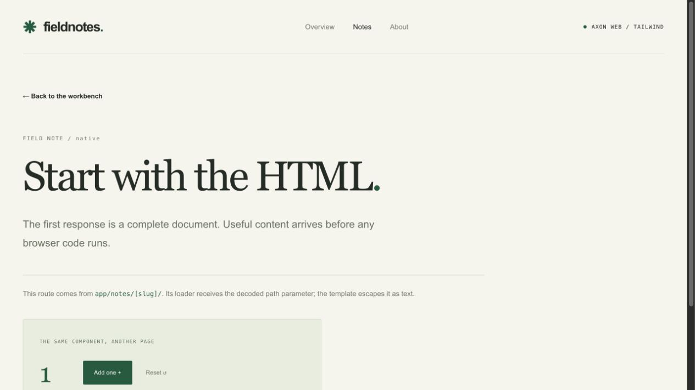
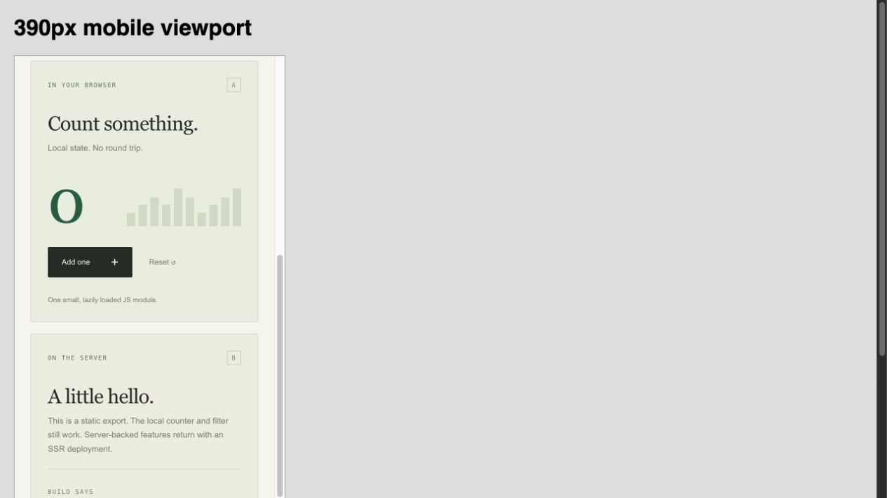

# Fieldnotes Tailwind integration performance

Apple M1 Pro / macOS-27.0-arm64-arm-64bit-Mach-O; Bun 1.3.13, Tailwind 4.3.3. Same native Axon compiler, release optimization, one server worker. Before is the original plain-CSS Fieldnotes snapshot.

The original framework libraries and the updated framework libraries are prepared outside timing; dependencies are already installed. Cold deletes project outputs and native application cache. The unchanged macOS compiler still uses its OS loader; separate Linux empty-root execution verifies the C-free deployment. These are local before/after measurements, not a new Astro comparison.

| Build | Before | Tailwind |
|---|---:|---:|
| cold | 1.238s | 1.348s |
| warm | 0.698s | 0.817s |

| Assets | Before | Tailwind |
|---|---:|---:|
| css_bytes | 9,967 | 15,739 |
| css_gzip_bytes | 2,796 | 4,416 |
| browser_js_bytes | 6,241 | 6,241 |
| home_html_bytes | 5,056 | 5,347 |
| binary_bytes | 260,528 | 260,528 |

Gzip sizes are offline estimates; the current server sends identity CSS. Tailwind ships no browser JavaScript.

| SSR | Version | Median req/s (range) | p99 ms | Sampled peak RSS MiB |
|---|---|---:|---:|---:|
| home | Before | 75,093 (70,886–85,500) | 0.47 | 23.12 |
| home | Tailwind | 80,096 (59,514–81,919) | 0.43 | 27.36 |
| greeting | Before | 74,608 (65,535–75,797) | 0.42 | 16.19 |
| greeting | Tailwind | 71,723 (69,782–76,597) | 0.52 | 15.73 |

20 timed builds, 12 load trials, zero accepted HTTP/socket errors. 3 shuffled rounds per route/version, 16 keepalive connections, 1s warmup + 3s load. RSS sampled every 150ms; this is not a full browser heap or energy measurement. Host scheduling and memory pressure affect short local samples. Static export, browser interactions, responsive CSS and Linux empty-root execution are checked separately.

Reproduce: `python3 bench/tailwind.py --before-root /path/to/pre-tailwind/axon-web --out build/tailwind-rerun`. Keep the baseline checkout unchanged and install current build dependencies with `bun install --frozen-lockfile`. Source snapshots/hashes and raw logs accompany this report.

[Verification](verification.json) and `checks/` contain passing native HTTP/static tests, 13 template/CSS tests, 4 browser-client tests, 7 benchmark oracle tests, actual dev-watcher edits/failure recovery, and Linux empty-root execution. SSR/static counters, filtering, escaped greetings, client navigation and a 390px static viewport were checked in the browser.

